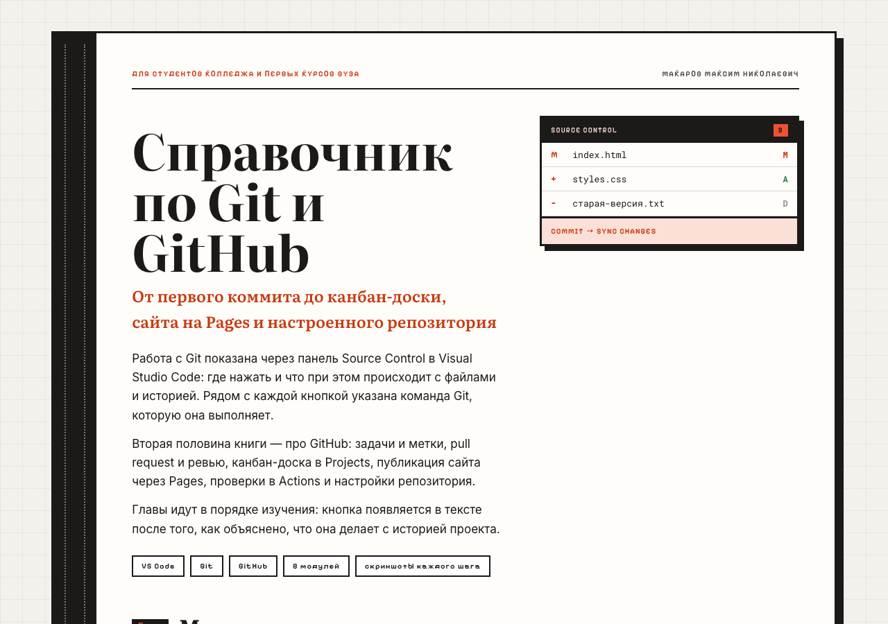

# Справочник по Git и GitHub

Пример README с изображением из папки `screenshots`.
На снимке показана обложка справочника, открытая в браузере.

## Что внутри

- `README.md` — описание примера и строка Markdown для картинки
- `screenshots/home.png` — снимок обложки справочника
- `docs/README.md` — тот же снимок по пути из вложенной папки

## Как открыть

[Открыть обложку справочника](../../../index.html).

## Снимок результата



## Исходная строка

```markdown

```

Восклицательный знак включает изображение. Текст в квадратных скобках
описывает его содержимое. Путь в круглых скобках начинается от папки этого README.
