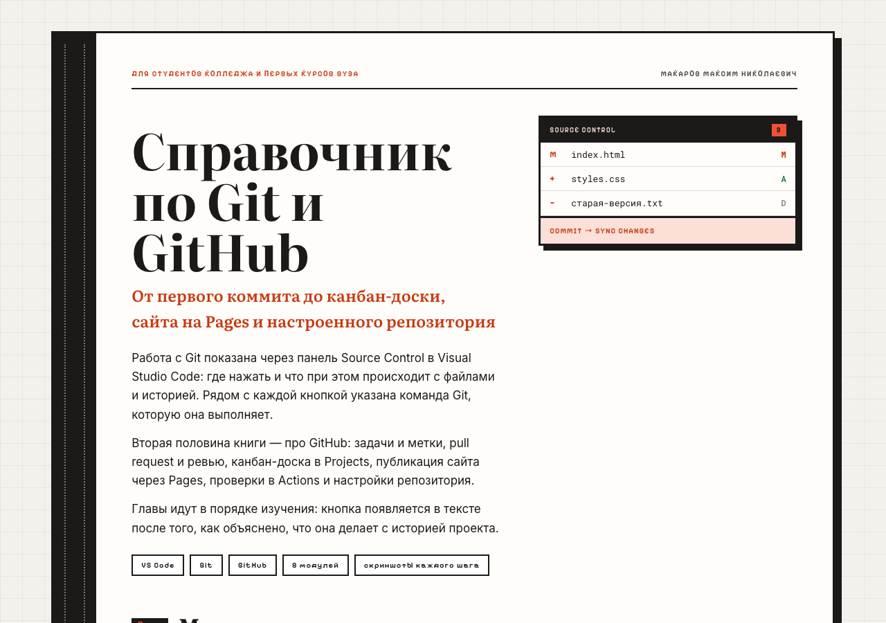

# Изображение из вложенного README

Этот файл находится в `docs/README.md`. Картинка находится в соседней
с `docs` папке `screenshots`, поэтому путь начинается с `../`.



```markdown

```

[Вернуться к описанию примера](../README.md).
